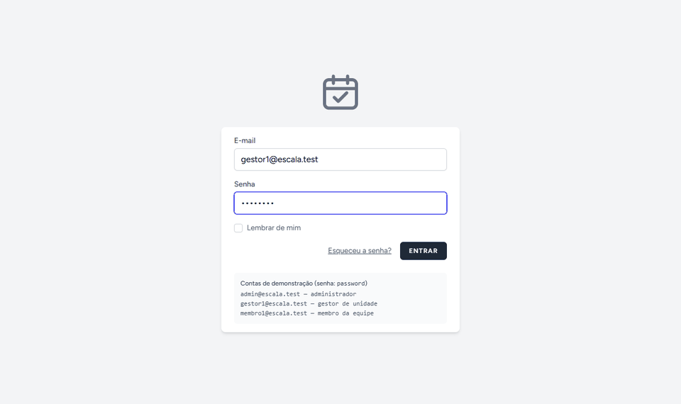
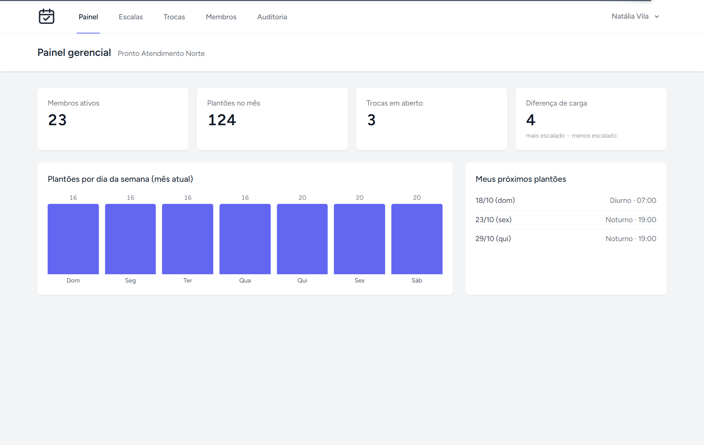
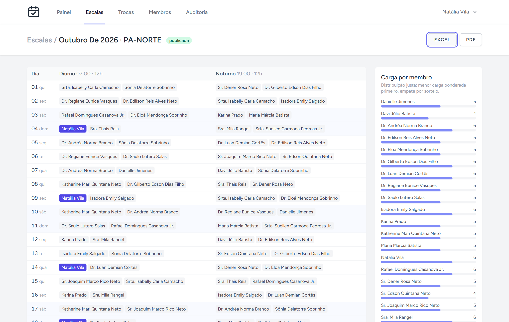
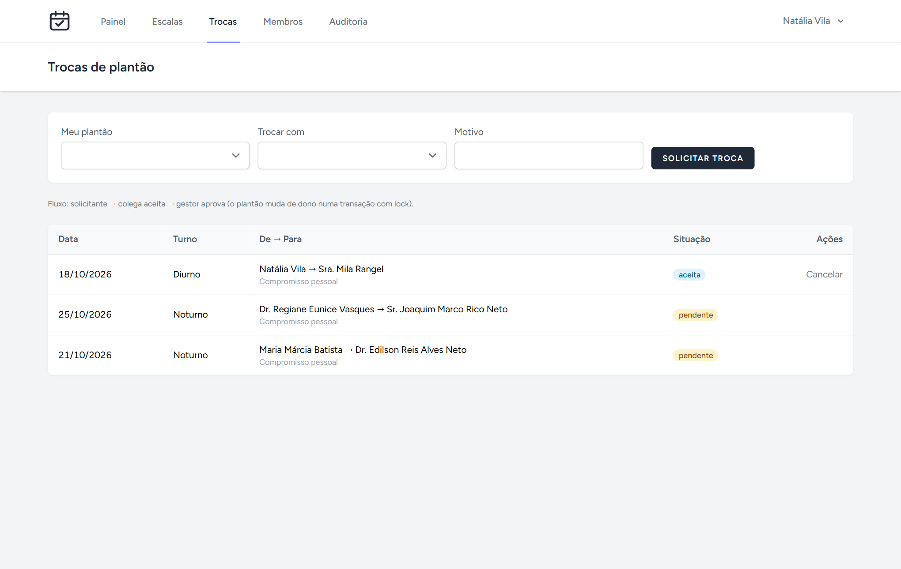
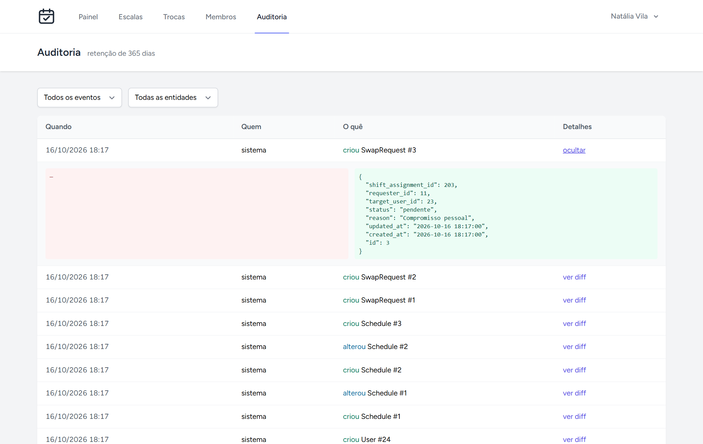
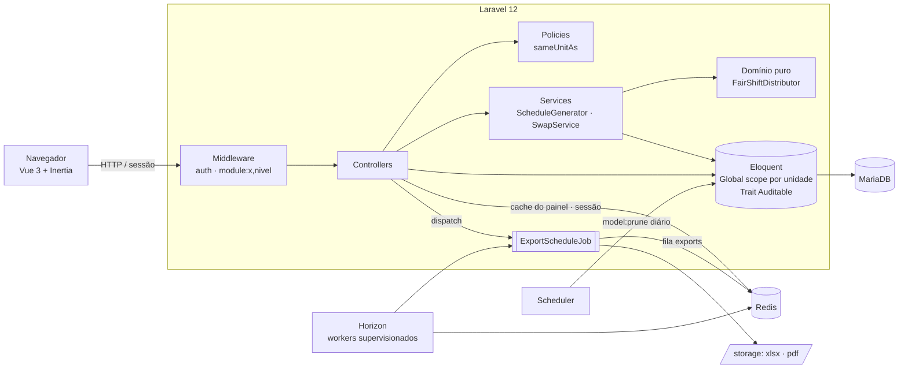

# Escala Plantão

[](https://github.com/Porzelt/escala-plantao/actions/workflows/ci.yml)
     

Gestão de **escalas de plantão** para equipes divididas em unidades: distribuição justa e
reprodutível de turnos, trocas com aprovação, exportação em fila, painel gerencial e trilha de auditoria.

> **Por que este projeto existe.** Trabalho desde 2023 num sistema governamental de alta
> disponibilidade cujo código é confidencial. Este repositório **reproduz, com código aberto e
> domínio fictício, os mesmos padrões que uso em produção** — Laravel + Inertia + Vue, RBAC por
> módulo com isolamento por unidade, filas no Horizon, auditoria com retenção, CI/CD no GitHub
> Actions e teste de carga com k6. Nenhum código, nome, dado ou endereço do sistema real foi usado.

[](https://codespaces.new/Porzelt/escala-plantao?quickstart=1)

**Teste sem instalar nada:** clique no botão acima (precisa estar logado no GitHub). Em ~3 minutos o
Codespaces sobe app, MariaDB, Redis e Horizon com os dados de demonstração e abre o sistema no navegador.
Entre com `gestor1@escala.test` / `password`.

> Se o VS Code perguntar *"Você confia nos autores desta pasta?"*, clique em **Confiar** — é o aviso padrão para
> qualquer repositório aberto pela primeira vez; sem isso o terminal não sobe o app. O app abre sozinho numa aba
> (ou pelo ícone 🌐 da porta 8000 no painel **Portas**).



> 🇺🇸 **In English:** on-call shift scheduling system built with Laravel 12, Inertia.js + Vue 3, MariaDB,
> Redis/Horizon and Docker. It showcases role/module-based access control with per-unit data isolation,
> a fair and reproducible (seeded) shift-distribution algorithm with unit tests, queued XLSX/PDF exports
> with a progress bar, an audit trail with retention, GitHub Actions CI (Pint + PHPUnit on MariaDB, 87.8%
> coverage) and a k6 load test: **450 concurrent authenticated users, 0% errors**. It mirrors, with
> fictitious data and open code, the patterns I use in production on a confidential government system.
> One-click demo via the Codespaces button above.



| Escala do mês | Trocas | Auditoria |
|---|---|---|
|  |  |  |

## Destaques

| | Onde olhar |
|---|---|
| **Distribuição justa** — guloso por menor carga ponderada (noturno/fim de semana pesam mais), descanso mínimo de 12 h, indisponibilidades, carga herdada do mês anterior e **sorteio com semente** (mesma semente ⇒ mesma escala) | [`FairShiftDistributor`](app/Domain/Scheduling/FairShiftDistributor.php) · [testes](tests/Unit/FairShiftDistributorTest.php) |
| **RBAC por perfil × módulo** — matriz em config, middleware `module:escalas,write`, gates por módulo, policies e o mesmo mapa enviado ao Vue para montar menu e botões | [`config/rbac.php`](config/rbac.php) · [`EnsureModuleAccess`](app/Http/Middleware/EnsureModuleAccess.php) · [`app/Policies`](app/Policies) |
| **Isolamento por unidade** — global scope + preenchimento automático de `unit_id` + policies; registro de outra unidade responde 404 | [`BelongsToUnit`](app/Models/Concerns/BelongsToUnit.php) · [testes](tests/Feature/AccessControlTest.php) |
| **Fila assíncrona** — exportação XLSX/PDF na fila `exports` do Horizon, 202 + polling com barra de progresso, retries e `failed()` | [`ExportScheduleJob`](app/Jobs/ExportScheduleJob.php) · [`useExportProgress`](resources/js/Composables/useExportProgress.js) |
| **Auditoria com retenção** — antes/depois só dos campos alterados, sem campos sensíveis, `model:prune` diário | [`Auditable`](app/Models/Concerns/Auditable.php) · [`AuditLog`](app/Models/AuditLog.php) |
| **Trocas de plantão** — solicita → colega aceita → gestor aprova, transferência em transação com `lockForUpdate` | [`SwapService`](app/Services/SwapService.php) |
| **Qualidade** — 71 testes (unit + feature) em MariaDB real, **87,8% de cobertura**, Pint, mínimo de 70% exigido no CI | [`tests/`](tests) · [`ci.yml`](.github/workflows/ci.yml) |
| **Carga** — 450 usuários simultâneos autenticados, **0% de erro**, p95 1,48 s (medido) | [`tests/k6`](tests/k6) |

## Arquitetura



Decisões registradas em ADRs curtos:

1. [Monólito Laravel + Inertia + Vue](docs/adr/0001-monolito-inertia.md)
2. [Isolamento por unidade com global scope + policies](docs/adr/0002-isolamento-por-unidade.md)
3. [Exportações em fila com Horizon](docs/adr/0003-filas-horizon.md)
4. [Algoritmo de distribuição justa](docs/adr/0004-distribuicao-justa.md)
5. [Auditoria e retenção](docs/adr/0005-auditoria-retencao.md)

## Perfis e módulos

| Módulo | Admin | Gestor | Membro |
|---|---|---|---|
| Escalas | escrita (todas as unidades) | escrita (sua unidade) | leitura |
| Membros | escrita | escrita (não cria admin) | — |
| Trocas | escrita | aprova da unidade | solicita / aceita |
| Auditoria | leitura | leitura (sua unidade) | — |
| Horizon | ✓ | — | — |

## Como rodar

**Mais rápido:** botão *Open in GitHub Codespaces* no topo — nada a instalar.

**Na sua máquina:** requer Docker. Não precisa de PHP nem Composer na máquina.

```bash
git clone https://github.com/Porzelt/escala-plantao.git && cd escala-plantao
cp .env.example .env

# dependências PHP usando a imagem do Sail
docker run --rm -v "$PWD:/var/www/html" -w /var/www/html laravelsail/php84-composer composer install

./vendor/bin/sail up -d
./vendor/bin/sail artisan key:generate
./vendor/bin/sail artisan migrate --seed
./vendor/bin/sail npm ci && ./vendor/bin/sail npm run build
./vendor/bin/sail artisan horizon      # workers das filas (outro terminal)
```

Acesse http://localhost — contas fictícias (senha `password`):

| E-mail | Perfil |
|---|---|
| `admin@escala.test` | administrador (vê todas as unidades e o Horizon em `/horizon`) |
| `gestor1@escala.test` | gestor do "Pronto Atendimento Norte" |
| `membro1@escala.test` | membro da mesma unidade |

### Testes e estilo

```bash
./vendor/bin/sail artisan test        # 71 testes, banco MariaDB "testing"
./vendor/bin/sail pint --test
```

## Teste de carga (k6)

Medido localmente num notebook (Ryzen 7 5700X, Docker Desktop, servidor embutido do PHP com 16 workers):

| Cenário | Requisições | Vazão | Erros | p95 |
|---|---:|---:|---:|---:|
| 150 usuários simultâneos | 16.878 | 149 req/s | 0,00% | 490 ms |
| **450 usuários simultâneos** | **56.232** | **263 req/s** | **0,00%** | **1,48 s** |

Cada usuário virtual faz login real e navega painel → escalas → trocas. Detalhes, como reproduzir
e resumos brutos em [`tests/k6`](tests/k6/README.md).

## CI/CD

- **[`ci.yml`](.github/workflows/ci.yml)** — em todo PR: Pint, build do front, PHPUnit com MariaDB e Redis como
  serviços e cobertura mínima de 70%; no `main`, smoke test k6 contra o app rodando.
- **[`deploy.yml`](.github/workflows/deploy.yml)** — exemplo do padrão usado em produção: runner self-hosted,
  release por diretório + symlink (zero downtime), migrations, `optimize`, `horizon:terminate`, health check e
  aprovação manual no ambiente de produção.

## Estrutura

```
app/
  Domain/Scheduling/   algoritmo puro (sem framework)
  Services/            orquestra domínio + banco
  Models/Concerns/     BelongsToUnit (isolamento) e Auditable (auditoria)
  Policies/            regras de autorização por recurso
  Jobs/  Exports/      exportação em fila
resources/js/Pages/    telas Vue 3 (Composition API)
tests/Unit             algoritmo
tests/Feature          RBAC, isolamento, fluxos, fila, auditoria
tests/k6               carga
docs/adr               decisões de arquitetura
```

---

Licença [MIT](LICENSE) · Feito por **Henrique Porzelt Neto** · [LinkedIn](https://linkedin.com/in/henriqueporzelt) · [GitHub](https://github.com/Porzelt)
